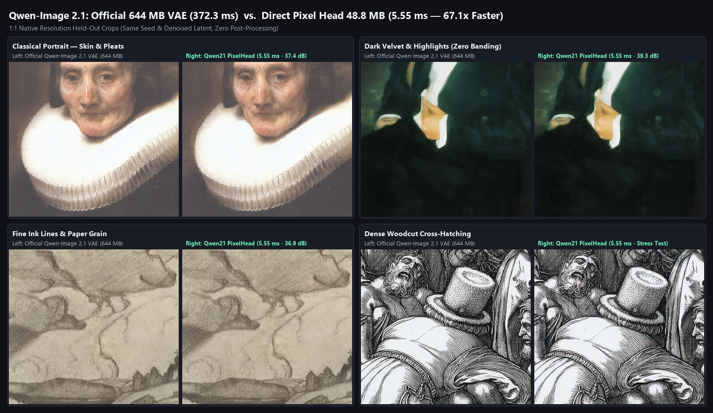

# ComfyUI-QwenImage21-PixelHead

Direct RGBA pixel readout head (`1x` & `2x`) for **Qwen-Image 2.1** in ComfyUI, replacing the `644.2 MiB` 64-channel WanVAE decoder at the end of sampling.

[English](README.md) | [简体中文](README_zh.md)

[](LICENSE)
[](https://huggingface.co/pocis/Qwen-Image-2.1-PixelHead)
[](https://registry.comfy.org/publishers/wither033/nodes/comfyui-qwenimage21-pixelhead)

Based on the direct pixel readout formulation in [*FastFrames* (`arXiv:2611.23226`)](https://arxiv.org/abs/2611.23226), this node captures the final sampling step's `4096`-dim hidden states right before `proj_out` together with the denoised `64`-channel latent `x0_hat`, and decodes them directly to 4-channel RGBA pixels (`25.4M` parameters, `48.8 MiB` in BF16).

At `768×768` on an NVIDIA L4, median decode time drops from `372.3 ms` (stock VAE) to `5.55 ms` (`67.1×`), with peak extra VRAM under `0.2 GB`.



## Features

- **Low latency and low VRAM**: Decodes in `5.55 ms` (`1x`) or `~12 ms` (`2x` `1024 → 2048`) and moves weights back to CPU after execution, avoiding high-resolution `VAEDecode` memory spikes.
- **High-dimensional input (`4096 + 64` channels)**: Unlike latent-only tiny decoders that read only the compressed `64`-channel latent, reading pre-`proj_out` DiT features retains small text and fine linework (`38.57 dB` PSNR on typography). The final linear layer runs in `FP32` to avoid `BF16` color banding on flat gradients.
- **Single checkpoint across sampling modes**:
  - Supports both 8-step Turbo LoRA (`CFG = 1.0`) and 20–35 step Base sampling (`CFG > 1.0`).
  - Supports Text-to-Image and `<image1>` multi-image reference editing (`norm_out` strips reference prefix tokens before `proj_out`).
  - Compatible with ComfyUI's `QwenImage21Cache`.
- **4-channel RGBA**: Outputs `image_rgb`, `alpha_mask`, and `image_rgba` in one pass.

## Benchmark (`768×768` Held-Out Split, NVIDIA L4)

Evaluated against `qwen_image_2.1_vae_bf16.safetensors` (`Comfy-Org/Qwen-Image-2.1`) on the same seeds and denoised latents (50% 8-step LoRA, 50% multi-step Base):

| Decoder | Size | Median Latency | Speedup | PSNR (↑) | LPIPS-VGG (↓) | RGBA |
| :--- | :---: | :---: | :---: | :---: | :---: | :---: |
| Official Qwen-Image 2.1 VAE | `644.2 MiB` | `372.30 ms` | `1.0×` | *(ref)* | `0.0000` | Yes |
| `QwenImage21 PixelHead` (`1x`) | `48.8 MiB` (BF16) / `97.0 MiB` (FP32) | `5.55 ms` | `67.1×` | `33.91 dB` | `0.1524` | Yes |

Held-out breakdown by category:
- Typography & posters: `38.57 dB` PSNR (`0.0653` LPIPS)
- 2D anime & cel shading: `34.69 dB` PSNR (`0.1363` LPIPS)
- Paintings & engravings: `33.76 dB` mean PSNR (`37.4–41.3 dB` on portraits and low-key lighting)

## Related Repositories

Each diffusion model has its own internal feature space and needs a separate pixel head:

| Model | ComfyUI Node | Weights | Notes |
| :--- | :--- | :--- | :--- |
| **Qwen-Image 2.1** *(this repo)* | [Wither033/ComfyUI-QwenImage21-PixelHead](https://github.com/Wither033/ComfyUI-QwenImage21-PixelHead) | [pocis/Qwen-Image-2.1-PixelHead](https://huggingface.co/pocis/Qwen-Image-2.1-PixelHead) | `48.8 MiB` (`1x`) / `52.1 MiB` (`1x`+`2x`), 4-ch RGBA, `5.55 ms` (`67.1×`), `33.91 dB` |
| **Krea-2** | [Wither033/ComfyUI-Krea2-PixelHead](https://github.com/Wither033/ComfyUI-Krea2-PixelHead) | [pocis/Krea-2-PixelHead](https://huggingface.co/pocis/Krea-2-PixelHead) | `52.6 MiB` BF16, `6144d` bridged RGB, `59.55 ms` (`24.7×`), `33.33 dB` |
| **MiniMax-H3** *(preview)* | [Wither033/ComfyUI-MiniMaxH3-PixelHead](https://github.com/Wither033/ComfyUI-MiniMaxH3-PixelHead) | [pocis/MiniMax-H3-Video-PixelHead](https://huggingface.co/pocis/MiniMax-H3-Video-PixelHead) | Experimental preview (not recommended for production yet; high-frequency textures are soft) |
| **Training Code & Notes** | [Wither033/FastFrames-PixelHead-Trainer](https://github.com/Wither033/FastFrames-PixelHead-Trainer) | [HF Collection](https://huggingface.co/collections/pocis/fastframes-zero-vae-direct-pixelheads-comfyui-6b031df8e9212f8bae294154) | Training toolkit, DiT hook notes, and Colab L4 scripts |

## Installation

### 1. Custom Node
Install via ComfyUI Manager (`ComfyUI-QwenImage21-PixelHead`), `comfy node install comfyui-qwenimage21-pixelhead`, or `git clone`:

```bash
cd ComfyUI/custom_nodes
git clone https://github.com/Wither033/ComfyUI-QwenImage21-PixelHead.git
```

### 2. Weights
Download from [pocis/Qwen-Image-2.1-PixelHead](https://huggingface.co/pocis/Qwen-Image-2.1-PixelHead) into `ComfyUI/models/pixel_heads/` (or `ComfyUI/models/vae/`):

- `qwen_image_2.1_pixel_head_bf16.safetensors` (`48.8 MiB`): `1x` native resolution (`5.55 ms`, BF16 trunk + FP32 output).
- `qwen_image_2.1_pixel_head_x2_bf16.safetensors` (`52.1 MiB`): combined `1x` + `2x` (`1024 → 2048` in `~12 ms`, switchable via `output_scale`).
- `qwen_image_2.1_pixel_head.safetensors` (`97.0 MiB`) / `qwen_image_2.1_pixel_head_x2.safetensors` (`103.3 MiB`): full FP32 checkpoints.

## Usage

Example workflows are in [`example_workflows/`](example_workflows/):
- [`01_QwenImage21_PixelHead_ZeroVAE_EN.json`](example_workflows/01_QwenImage21_PixelHead_ZeroVAE_EN.json)
- [`01_QwenImage21_PixelHead_免VAE极速直出与对比_ZH.json`](example_workflows/01_QwenImage21_PixelHead_免VAE极速直出与对比_ZH.json)

```text
[Load Diffusion Model] ──► (Optional 8-Step LoRA / QwenImage21Cache) ──► [Qwen-Image 2.1 Pixel Head Tap]
                                                                               │              │
                                                                          MODEL│              │pixel_tap
                                                                               ▼              │
                                                                          [KSampler]          │
                                                                               │LATENT        │
                                                                               ▼              ▼
                                   [Load Qwen-Image 2.1 Pixel Head] ──► [Qwen-Image 2.1 Pixel Decode (Zero VAE)]
```

For pure Text-to-Image, no VAE needs to be loaded. For `<image1>` reference editing, keep a VAE connected to `TextEncodeQwenImage21` to encode the input image, and use `Qwen-Image 2.1 Pixel Decode` after `KSampler`.

## Limitations

- **Step range**: Trained on `ModelSamplingFlux(shift=0.69)` final-step $\sigma \in [0.038, 0.300]$ (5–12 step Turbo LoRA and 18–35 step Base).
- **Offline `.latent` files**: Decoding requires the final-step `4096`-dim DiT features captured by the Tap node during sampling; it cannot decode standalone saved `.latent` files on their own.
- **Dense micro-hatching**: On fine monochrome woodcuts or 2px screentones, 1px phase shifts lower pixelwise PSNR even though line structure stays separated.

## License & Credits

- **License**: MIT (clean-room PyTorch implementation).
- **References**: Direct pixel readout formulation from [*FastFrames: Video Generation at Interactive Latency*](https://arxiv.org/abs/2611.23226) (Apple Research, 2026); single-step replay distillation and ComfyUI hook design informed by `sorryhyun/anima-pixel-decoder`.
