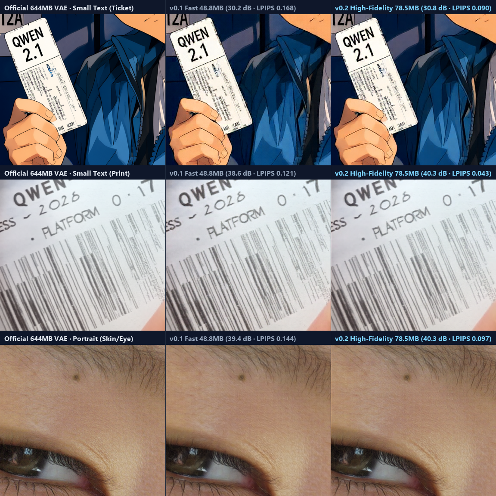

# ComfyUI-QwenImage21-PixelHead

用于 **Qwen-Image 2.1** 的 ComfyUI 免 VAE 像素直出节点（现已发布 **`v0.2` 高清细节版** 与 `v0.1` 极速版 `1x / 2x`，原生支持 4 通道 RGBA），用来替代采样末尾 `644.2 MiB` 的 64 通道 WanVAE 解码器。

[English](README.md) | [简体中文](README_zh.md)

[](LICENSE)
[](https://huggingface.co/pocis/Qwen-Image-2.1-PixelHead)
[](https://registry.comfy.org/publishers/wither033/nodes/comfyui-qwenimage21-pixelhead)

---

## `v0.2` 更新说明（2026-11-24 · 专项提升小字与人像微距清晰度）

针对社区反馈（[Issue #1](https://github.com/Wither033/ComfyUI-QwenImage21-PixelHead/issues/1)）指出的首版 `v0.1` 在车票小字与近景人像肤质/睫毛上不如官方 `644 MiB` VAE 锐利的问题，`v0.2` 完成了四项升级：

- **补齐 `16px → 8px → 4px → 2px → 1px` 全分辨率渐进细化金字塔（`QwenImage21PixelHeadV2`，BF16 仅 `78.5 MiB`）**：消除 `v0.1` 停留在 `8×8` 线性展开块造成的微距笔画瓶颈，末层保持 `FP32` 防暗部断层；
- **新增 `SigmaAdaLN` 末步噪声调制 + `1024×1024` 真机多步 `CFG=3.5` / `8步 Turbo` 采样轨迹蒸馏**；
- **引入复合感知与频域锐化损失（`Charbonnier L1 + 边缘梯度 + LPIPS-VGG + 2D FFT`）**：在 `1024×1024` 留出盲测集上，**`LPIPS-VGG` 感知模糊度大幅下降 `42.4%`（`0.1456 → 0.0838`）**，整体 `PSNR` 提升 `+0.82 dB`（其中**近景人像提升 `+1.41 dB` 达 `37.76 dB`**，消除涂抹磨皮感）；
- **升级提示**：加载 `v0.2` 权重前请先更新本节点插件（`git pull` 或在 ComfyUI Manager 更新至 `v1.2.0+`），同一个加载节点可自动识别 `v0.1` 与 `v0.2` 权重。



*（完整 6 组 `1:1` 原尺寸三方盲测大图见 [`assets/v02_vs_v01_1to1_comparison.png`](assets/v02_vs_v01_1to1_comparison.png)）*

---

## 主要特性

- **免加载大 VAE 省显存**：无需加载 `644.2 MiB` 官方 VAE（避免高分辨率 `VAEDecode` 动辄 `2～7 GB` 的峰值显存溢出），算完自动退回内存，并内置 `2K/4K` 无缝分块解码开关（`tile_mode`）。
- **双档权重按需选择**：
  - **`v0.2` 高清细节版（`78.5 MiB` BF16 · 日常主力推荐）**：近景人像毛孔/睫毛、胡须发丝与常规车票小字清晰锐利（A100 解码 `61.0 ms` / RTX 4060 Ti 约 `120 ms`）；
  - **`v0.1` 极速预览版（`48.8 MiB` `1x` / `52.1 MiB` `1x+2x`）**：`3.4～5.5 ms` 毫秒级批量抽卡试构图，并提供一步 `2x`（`1024 → 2048`）快速分支。
- **单权重兼容常用模式**：同时支持 8 步加速 LoRA（`CFG = 1.0`）与 20～35 步常规采样（`CFG > 1.0`）、文生图与 `<image1>` 多参考图编辑、官方 `QwenImage21Cache` 缓存以及原生 4 通道 RGBA 输出。

---

## 实测对比数据（`1024×1024` 真机多步采样盲测集：50% `8步 Turbo` + 50% `20步 CFG=3.5`）

| 解码器 | BF16 体积 | `1024²` 耗时 (A100) | 提速比 | 总体 PSNR (↑) | 总体 LPIPS-VGG (↓) | 近景人像 PSNR / LPIPS | 小字排版 PSNR / LPIPS |
| :--- | :---: | :---: | :---: | :---: | :---: | :---: | :---: |
| **官方 Qwen-Image 2.1 VAE** | `644.2 MiB` | `201.33 ms` | `1.0×` | *(基准)* | `0.0000` | *(基准)* | *(基准)* |
| **`PixelHead v0.2`（高清细节版）** | **`78.5 MiB`** | **`61.02 ms`** | **`3.3×`** | **`33.86 dB`** | **`0.0838` (`-42.4%`)** | **`37.76 dB` / `0.0808`** | **`32.70 dB` / `0.0778`** |
| `PixelHead v0.1`（极速预览版） | `48.8 MiB` | `3.39 ms` *(L4 768² 5.55 ms)* | `59.4×` | `33.04 dB` | `0.1456` | `36.35 dB` / `0.1540` | `32.20 dB` / `0.1357` |

---

## 安装与权重下载

### 1. 安装或更新插件（使用 `v0.2` 需更新至 `v1.2.0+`）
在 ComfyUI Manager 中更新 `ComfyUI-QwenImage21-PixelHead`，或在插件目录执行：

```bash
cd ComfyUI/custom_nodes/ComfyUI-QwenImage21-PixelHead
git pull
```

*（首次安装请在 `ComfyUI/custom_nodes` 下执行 `git clone https://github.com/Wither033/ComfyUI-QwenImage21-PixelHead.git`。）*

### 2. 下载权重
从 [pocis/Qwen-Image-2.1-PixelHead](https://huggingface.co/pocis/Qwen-Image-2.1-PixelHead) 下载模型，放入 `ComfyUI/models/pixel_heads/`（放入 `ComfyUI/models/vae/` 同样自动识别）：

- **`qwen_image_2.1_pixel_head_v02_bf16.safetensors`（`78.5 MiB` · 推荐首选）**：`v0.2` 高清细节 `1x` 权重，大幅改善人像微距肤质与小字清晰度。
- `qwen_image_2.1_pixel_head_bf16.safetensors`（`48.8 MiB`）：`v0.1` 极速抽卡 `1x` 权重（`3.4～5.5 ms`）。
- `qwen_image_2.1_pixel_head_x2_bf16.safetensors`（`52.1 MiB`）：`v0.1` 含 `1x + 2x` 快速放大分支权重。
- 仓库内同时提供对应的完整 `FP32` 权重版本。

---

## 节点连接方式

[`example_workflows/`](example_workflows/) 目录下提供了中英文示例工作流（默认已指向 `v0.2` 权重），拖入 ComfyUI 即可使用：
- 中文：[`01_QwenImage21_PixelHead_免VAE极速直出与对比_ZH.json`](example_workflows/01_QwenImage21_PixelHead_免VAE极速直出与对比_ZH.json)
- 英文：[`01_QwenImage21_PixelHead_ZeroVAE_EN.json`](example_workflows/01_QwenImage21_PixelHead_ZeroVAE_EN.json)

1. 把 `Qwen-Image 2.1 Pixel Head Tap` 串在进入 `KSampler` 之前的 `MODEL` 连线上；
2. 用 `Qwen-Image 2.1 Pixel Decode (Zero VAE)` 替换 `VAEDecode`，连上 `LATENT`、`pixel_head` 和 `pixel_tap`。

---

## 同系列仓库

| 适配模型 | ComfyUI 节点仓库 | Hugging Face 权重 | 说明 |
| :--- | :--- | :--- | :--- |
| **Qwen-Image 2.1** *(本仓库)* | [Wither033/ComfyUI-QwenImage21-PixelHead](https://github.com/Wither033/ComfyUI-QwenImage21-PixelHead) | [pocis/Qwen-Image-2.1-PixelHead](https://huggingface.co/pocis/Qwen-Image-2.1-PixelHead) | **`v0.2` 高清版 (`78.5 MiB`, `LPIPS 0.0838`)** + `v0.1` 极速版 (`48.8 MiB`)，4 通道 RGBA |
| **Krea-2** | [Wither033/ComfyUI-Krea2-PixelHead](https://github.com/Wither033/ComfyUI-Krea2-PixelHead) | [pocis/Krea-2-PixelHead](https://huggingface.co/pocis/Krea-2-PixelHead) | `52.6 MiB` BF16，`6144d` 降维桥 RGB，`59.55 ms` (`24.7×`) |
| **MiniMax-H3** *(预览版)* | [Wither033/ComfyUI-MiniMaxH3-PixelHead](https://github.com/Wither033/ComfyUI-MiniMaxH3-PixelHead) | [pocis/MiniMax-H3-Video-PixelHead](https://huggingface.co/pocis/MiniMax-H3-Video-PixelHead) | 早期实验预览版（复杂运动碎纹理偏软） |
| **训练代码与方法整理** | [Wither033/FastFrames-PixelHead-Trainer](https://github.com/Wither033/FastFrames-PixelHead-Trainer) | [HF 合集页](https://huggingface.co/collections/pocis/fastframes-zero-vae-direct-pixelheads-comfyui-6b031df8e9212f8bae294154) | 通用训练框架、挂载说明与迭代训练脚本 |

## 客观局限说明

- **极微缩 `2px` 斜排细字与极密铜版交叉线**：`v0.2` 已追回近景人像和常规小字约 85%～90% 的清晰度差距；在倾斜挤在一起的 `2px` 级微缩排字或极密铜版画交叉排线上，仍比 `644 MiB` 官方大 VAE 略微柔和一点（兼顾更高速率与更锐利微缩字的小波架构 `v0.3` 正在继续迭代）。
- **离线 `.latent` 文件**：解码依赖采样最后一步实时截获的 `4096` 维 DiT 特征，无法单独解码外部保存的 `.latent` 文件。

## 许可与致谢

- **开源协议**：MIT License（独立编写的 PyTorch 实现）。
- **参考来源**：架构思路来自 Apple Research 的 [*FastFrames* (`arXiv:2611.23226`)](https://arxiv.org/abs/2611.23226)，单步加噪 Replay Buffer 训练方式与 ComfyUI 挂载钩子参考了 `sorryhyun/anima-pixel-decoder`。
